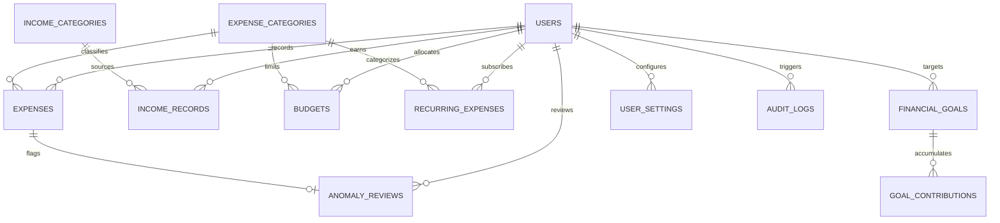

# Database Design Documentation

**Expense Behaviour Analytical Platform (EBAP)**

## 1. Relational Schema Summary

The database is normalized to Third Normal Form (3NF) using the MySQL/MariaDB **InnoDB** storage engine with full foreign key constraints and UTF-8 multi-byte encoding (`utf8mb4_unicode_ci`).

---

## 2. Table Specifications

### 1. `users`
Stores user profile, authentication hashes, and display preferences.
- `id` INT AUTO_INCREMENT PRIMARY KEY
- `full_name` VARCHAR(100) NOT NULL
- `email` VARCHAR(150) NOT NULL UNIQUE (Indexed)
- `password_hash` VARCHAR(255) NOT NULL (bcrypt)
- `preferred_currency` VARCHAR(10) DEFAULT 'INR'
- `timezone` VARCHAR(50) DEFAULT 'Asia/Kolkata'
- `account_status` ENUM('active', 'inactive', 'suspended') DEFAULT 'active'
- `created_at` TIMESTAMP DEFAULT CURRENT_TIMESTAMP
- `updated_at` TIMESTAMP DEFAULT CURRENT_TIMESTAMP ON UPDATE CURRENT_TIMESTAMP

### 2. `expense_categories`
System default categories (`user_id = NULL`) and user-created custom categories.
- `id` INT AUTO_INCREMENT PRIMARY KEY
- `user_id` INT NULL (Foreign Key -> `users.id` ON DELETE CASCADE)
- `category_name` VARCHAR(100) NOT NULL
- `category_icon` VARCHAR(50) DEFAULT 'bi-tag'
- `category_color` VARCHAR(20) DEFAULT '#4f46e5'
- `is_essential` TINYINT(1) DEFAULT 0 (1 = Essential Need, 0 = Discretionary)
- `status` ENUM('active', 'inactive') DEFAULT 'active'
- `created_at` TIMESTAMP DEFAULT CURRENT_TIMESTAMP

### 3. `income_categories`
Income classification categories (Salary, Freelance, Business, Investments, etc.).
- `id` INT AUTO_INCREMENT PRIMARY KEY
- `user_id` INT NULL (Foreign Key -> `users.id` ON DELETE CASCADE)
- `category_name` VARCHAR(100) NOT NULL
- `category_icon` VARCHAR(50) DEFAULT 'bi-wallet2'
- `category_color` VARCHAR(20) DEFAULT '#10b981'
- `status` ENUM('active', 'inactive') DEFAULT 'active'
- `created_at` TIMESTAMP DEFAULT CURRENT_TIMESTAMP

### 4. `expenses`
All expense transactions recorded by users.
- `id` INT AUTO_INCREMENT PRIMARY KEY
- `user_id` INT NOT NULL (Foreign Key -> `users.id` ON DELETE CASCADE)
- `category_id` INT NOT NULL (Foreign Key -> `expense_categories.id`)
- `title` VARCHAR(200) NOT NULL
- `amount` DECIMAL(12, 2) NOT NULL (Decimal precision for currency)
- `transaction_date` DATE NOT NULL
- `payment_method` ENUM('Cash', 'UPI', 'Credit Card', 'Debit Card', 'Net Banking', 'Cheque', 'Other') DEFAULT 'UPI'
- `merchant` VARCHAR(150) NULL
- `description` TEXT NULL
- `is_recurring` TINYINT(1) DEFAULT 0
- `recurring_expense_id` INT NULL
- `import_reference` VARCHAR(100) NULL
- `created_at` TIMESTAMP DEFAULT CURRENT_TIMESTAMP
- `updated_at` TIMESTAMP DEFAULT CURRENT_TIMESTAMP ON UPDATE CURRENT_TIMESTAMP
- Indexes: `(user_id, transaction_date)`, `(user_id, category_id)`

### 5. `income_records`
Inflow and earnings records.
- `id` INT AUTO_INCREMENT PRIMARY KEY
- `user_id` INT NOT NULL (Foreign Key -> `users.id` ON DELETE CASCADE)
- `category_id` INT NOT NULL (Foreign Key -> `income_categories.id`)
- `title` VARCHAR(200) NOT NULL
- `amount` DECIMAL(12, 2) NOT NULL
- `received_date` DATE NOT NULL
- `payment_method` ENUM('Bank Transfer', 'Cash', 'UPI', 'Cheque', 'Other') DEFAULT 'Bank Transfer'
- `payer` VARCHAR(150) NULL
- `description` TEXT NULL
- `is_recurring` TINYINT(1) DEFAULT 0
- `created_at` TIMESTAMP DEFAULT CURRENT_TIMESTAMP
- `updated_at` TIMESTAMP DEFAULT CURRENT_TIMESTAMP ON UPDATE CURRENT_TIMESTAMP

### 6. `budgets`
Spending limits defined overall or per category.
- `id` INT AUTO_INCREMENT PRIMARY KEY
- `user_id` INT NOT NULL (Foreign Key -> `users.id` ON DELETE CASCADE)
- `category_id` INT NULL (NULL for overall monthly budget)
- `budget_name` VARCHAR(150) NOT NULL
- `budget_amount` DECIMAL(12, 2) NOT NULL
- `period_type` ENUM('monthly', 'weekly', 'yearly', 'custom') DEFAULT 'monthly'
- `start_date` DATE NOT NULL
- `end_date` DATE NOT NULL
- `warning_threshold` INT DEFAULT 80
- `status` ENUM('active', 'inactive') DEFAULT 'active'

### 7. `recurring_expenses`
Ongoing subscriptions and recurring obligations.
- `id` INT AUTO_INCREMENT PRIMARY KEY
- `user_id` INT NOT NULL (Foreign Key -> `users.id` ON DELETE CASCADE)
- `category_id` INT NOT NULL (Foreign Key -> `expense_categories.id`)
- `title` VARCHAR(200) NOT NULL
- `amount` DECIMAL(12, 2) NOT NULL
- `frequency` ENUM('weekly', 'monthly', 'quarterly', 'yearly') DEFAULT 'monthly'
- `start_date` DATE NOT NULL
- `next_due_date` DATE NOT NULL
- `end_date` DATE NULL
- `payment_method` VARCHAR(50) DEFAULT 'UPI'
- `notes` TEXT NULL
- `status` ENUM('active', 'paused', 'cancelled') DEFAULT 'active'

### 8. `financial_goals`
Targets for saving or expense reduction.
- `id` INT AUTO_INCREMENT PRIMARY KEY
- `user_id` INT NOT NULL (Foreign Key -> `users.id` ON DELETE CASCADE)
- `goal_name` VARCHAR(150) NOT NULL
- `goal_type` ENUM('savings', 'spending_reduction', 'category_cap') DEFAULT 'savings'
- `category_id` INT NULL
- `target_amount` DECIMAL(12, 2) NOT NULL
- `baseline_amount` DECIMAL(12, 2) DEFAULT 0.00
- `current_progress` DECIMAL(12, 2) DEFAULT 0.00
- `start_date` DATE NOT NULL
- `target_date` DATE NOT NULL
- `status` ENUM('in_progress', 'achieved', 'abandoned') DEFAULT 'in_progress'
- `description` TEXT NULL

### 9. `goal_contributions`
Individual fund contributions deposited towards financial goals.
- `id` INT AUTO_INCREMENT PRIMARY KEY
- `goal_id` INT NOT NULL (Foreign Key -> `financial_goals.id` ON DELETE CASCADE)
- `user_id` INT NOT NULL (Foreign Key -> `users.id` ON DELETE CASCADE)
- `amount` DECIMAL(12, 2) NOT NULL
- `contribution_date` DATE NOT NULL
- `description` VARCHAR(255) NULL

### 10. `anomaly_reviews`
Statistical outlier detections flagged for user review.
- `id` INT AUTO_INCREMENT PRIMARY KEY
- `user_id` INT NOT NULL (Foreign Key -> `users.id` ON DELETE CASCADE)
- `expense_id` INT NULL (Foreign Key -> `expenses.id` ON DELETE CASCADE)
- `category_id` INT NULL (Foreign Key -> `expense_categories.id` ON DELETE SET NULL)
- `detection_method` VARCHAR(100) NOT NULL
- `baseline_value` DECIMAL(12, 2) NOT NULL
- `observed_value` DECIMAL(12, 2) NOT NULL
- `explanation` TEXT NOT NULL
- `review_status` ENUM('pending', 'reviewed', 'dismissed', 'false_positive') DEFAULT 'pending'
- `created_at` TIMESTAMP DEFAULT CURRENT_TIMESTAMP
- `reviewed_at` TIMESTAMP NULL

### 11. `user_settings`
Key-value preferences for dates, dashboard defaults, etc.
- `id` INT AUTO_INCREMENT PRIMARY KEY
- `user_id` INT NOT NULL (Foreign Key -> `users.id` ON DELETE CASCADE)
- `setting_key` VARCHAR(100) NOT NULL
- `setting_value` TEXT NOT NULL
- UNIQUE KEY `(user_id, setting_key)`

### 12. `login_attempts`
Tracks failed login attempts for IP/email rate limiting.
- `id` INT AUTO_INCREMENT PRIMARY KEY
- `ip_address` VARCHAR(45) NOT NULL
- `email` VARCHAR(150) NOT NULL
- `attempted_at` TIMESTAMP DEFAULT CURRENT_TIMESTAMP

### 13. `audit_logs`
Audit trails for security-sensitive user actions (login, password change, deletion).
- `id` INT AUTO_INCREMENT PRIMARY KEY
- `user_id` INT NOT NULL (Foreign Key -> `users.id` ON DELETE CASCADE)
- `action` VARCHAR(100) NOT NULL
- `entity_type` VARCHAR(50) NOT NULL
- `entity_id` INT NULL
- `details` TEXT NULL
- `ip_address` VARCHAR(45) NULL
- `created_at` TIMESTAMP DEFAULT CURRENT_TIMESTAMP
